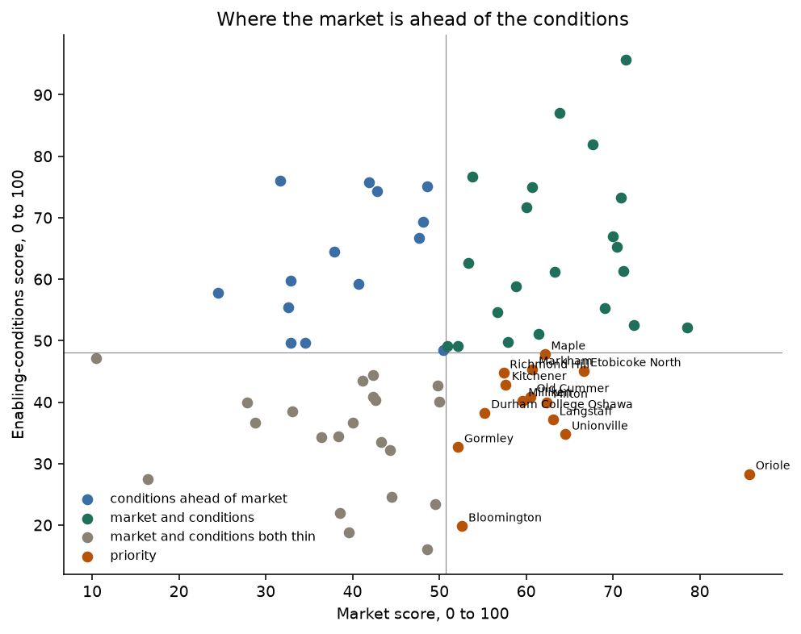
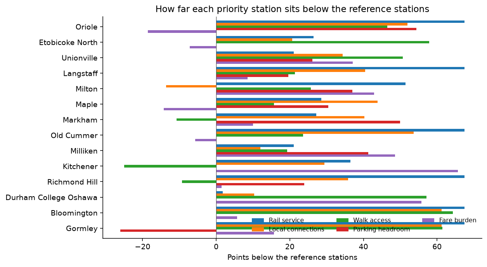

# Identifying stations where travel-market potential exceeds current access, service, and connectivity conditions.

A station scorecard for GO Transit and UP Express. I ask where the surrounding travel market is ahead of the conditions that would let that market show up as ridership, and I name the condition that is furthest behind.

This is an independent open-data project. It is not a Metrolinx publication, and it does not estimate boardings.

The stakeholder note is [reports/executive_brief.md](reports/executive_brief.md). The methods are in [reports/methods_note.md](reports/methods_note.md). The walk-through is [notebooks/scorecard.ipynb](notebooks/scorecard.ipynb). The map is [reports/station_map.html](reports/station_map.html).

## Research question

Which GO and UP stations have a strong surrounding travel market, but weak walk access, local connections, rail service, parking headroom, or fare?

I do not ask which stations have low ridership. Station boardings and PRESTO transactions are not on the open-data page, so a ridership model would have been a guess. The scorecard is the question I can defend with public files.

Union Station is the network destination, and Stratford sits outside the tracted census area. I leave both out of the ranking. I score the other 70 stations.

## Methodology

I did the work in this order. Settings and thresholds are in `src/scorecard/config.py`. The service counts are DuckDB queries in `sql/`.

1. I measured timetable quality from the current GO and UP Express feeds for Wednesday 18 November 2026, Saturday 21 November 2026, and Sunday 22 November 2026. A departure is a stop where a passenger can board. A trip toward Union is one that reaches Union later on the same trip. The AM peak is 06:00 to 09:00. The service measures are the median AM headway toward Union, the longest midday gap, the weekday span, and the weekend span. Trip counts stay in the table as evidence.
2. I took each of 14 local operators' busiest Wednesday, because the feeds are not on the same calendar. I counted bus arrivals within 250 m of the station, and the scheduled wait from an AM-peak bus arrival to the next train toward Union. The minimum connection is 3 minutes. Waits are capped at 60 minutes.
3. I built two catchments. The walkshed is 800 m on the OpenStreetMap walking network, buffered by 60 m so it can be overlaid on census areas. Walk reach is that area divided by the area of an 800 m circle. The station shed is the area closer to that station than to any other, capped at 10 km. It stands in for the drive and local-transit market.
4. I area-weighted 2021 Census population, jobs, and recent housing into those catchments. Income is a population-weighted average of dissemination-area medians, because a median cannot be split by area. I use that income as the value of time and as the denominator of the fare score. The Toronto commute share is a property of the census subdivision the station sits in.
5. I scored market and conditions from 0 to 100. Higher is better. Each input is a percentile rank among the stations I score.

**Market score**, equal weight: people plus jobs in the station shed, the share of the home municipality's commuters whose usual workplace is Toronto, and the share of occupied dwellings built from 2016 to 2021. Work from home sits beside the score. I do not subtract it from the market.

**Conditions score**, equal weight:

| Condition | What goes in | Direction |
| --- | --- | --- |
| Rail service | AM-peak headway toward Union, the longest midday gap, weekday span, and weekend span | A short headway and a short gap score higher. A longer span scores higher |
| Local connections | AM-peak bus arrivals, and the median AM-peak scheduled wait | A long wait scores lower |
| Walk access | People plus jobs in the walkshed, and walk reach | A thin walkshed scores lower |
| Parking headroom | One minus 2019 mean weekday occupancy | A full lot scores lower |
| Fare | Generalized cost of a scheduled trip to Union per $10,000 of shed household income | A heavier cost scores lower |

The generalized cost is the published fare plus a value of time on the scheduled ride and on half the AM headway. The value of time is half the shed median household income, spread over 2,080 hours. Walk time and the bus-to-train wait stay in the walk and feeder scores. The fare file has one price per zone pair, so I do not apply a PRESTO discount. I check a $1 reduction, a 10% reduction, a timed arrival, and a value of time at 35% and at 70% of the wage, and I report where the largest deficit changes.

Parking is scored only for origin stations with a lot of at least 50 spaces. Where parking is missing, I drop it and renormalize the other weights. I also recompute the conditions score with access weighted twice as heavily, and again with service weighted twice as heavily, and I report the rank correlation.

**Analysis 1** splits the stations at the median of each score. A priority station has a market score at or above the median and a conditions score below it. I also mark a station within 5 points of either median, and I recompute the priority set at the 40th and 60th percentiles of the conditions score. The quadrant says where to look. It does not name a cause. The medians on this run are in the interpretation below, and they are regenerated with the brief.

**Analysis 2** names the primary likely constraint for the priority stations. The reference group is the stations with both a strong market and strong conditions. The deficit on a condition is the reference median minus the station's score. The largest deficit is the label. Its share is that deficit divided by the sum of the positive deficits. If the second deficit is within 10 points, I call a tie and I do not recommend a single project.

Land use replaces that label when the housing-growth rank is at least 67 and the walk-catchment rank is 33 or lower. The market is being carried by growth that has not yet produced a walkable station. I keep the largest numeric deficit beside that label. I also recompute the deficit against the station's own line. Where the label changes, I say so, and I do not treat the call as firm.

For each priority station, and for the Kitchener stations I look at up close, I write a competing-evidence row: the primary label, the second-largest deficit, the numbers behind the label, the condition that argues against it, and a confidence of high, medium, or low. That table is `reports/evidence.csv`.

## Data sources

I downloaded the inputs on 15 November 2026. Raw files are not in git. Licences and links are in [data/SOURCES.md](data/SOURCES.md).

| Input | What I use it for | Publisher |
| --- | --- | --- |
| GO GTFS | Stations, the three service dates, fare from each zone to Union | Metrolinx Open Data |
| UP Express GTFS | UP stations and service on the same dates, including Pearson | Metrolinx Open Data |
| Parking file, December 2019 | Lot capacity and weekday occupancy | Metrolinx Open Data |
| 14 local GTFS feeds | Stops within 250 m, AM-peak arrivals, scheduled transfer waits | Mobility Database, each agency's own feed |
| 2021 Census Profile, dissemination area | Population, recent dwellings, income, work from home, commute mode | Statistics Canada, via the Data for Canada Parquet copy of 98-401-X. I checked the characteristic IDs against the official profile |
| 2021 boundaries | Dissemination areas, tracts, and subdivisions for the catchments | Statistics Canada |
| Table 98-10-0498 | Jobs by census tract of usual place of work | Statistics Canada |
| Table 98-10-0459 | Commuting flows to Toronto, by census subdivision | Statistics Canada |
| Ontario OpenStreetMap extract | Walking network for the 800 m walksheds | Geofabrik, Open Database Licence |

I do not use station-level GO ridership or PRESTO.

## Interpretation

Fifteen stations fall in the priority set. The market median is 50.7 and the conditions median is 47.5. The reference group is 20 stations. The full table, the owner of each action, and the competing-evidence rows are in the [executive brief](reports/executive_brief.md).

I also split the conditions score at the 40th percentile (43.4) and the 60th (53.7). Twelve priority stations sit below the 40th, so they stay in the set at all three cuts: Bloomington, Durham College Oshawa, Etobicoke North, Gormley, Langstaff, Markham, Milliken, Milton, Old Cummer, Oriole, Richmond Hill, and Unionville. Kitchener, Mount Joy, and Maple are priority at the median and not at the 40th. I treat those three as threshold-sensitive. Downsview Park, Guelph Central, Mount Pleasant, and Streetsville would join only if I moved the conditions cut up to the 60th.

| What I would act on | Stations | How I read it |
| --- | --- | --- |
| Rail service | Richmond Hill | The only station whose largest deficit is the timetable. Toward Union the AM headway is 30 minutes, there is no second midday train inside 09:30 to 15:00, and the weekend span is zero. Local connections is within 10 points. On its own line the deficit moves to fare, and the share is 28%, so the confidence is low. |
| Local connections | Langstaff, Maple, Old Cummer | Langstaff has 48 AM-peak bus arrivals and a 26 minute median wait. Old Cummer has 18 arrivals and a 28 minute wait. Maple has 9 arrivals and an 18 minute wait. Langstaff and Old Cummer share the Richmond Hill timetable, and on that line the deficit moves back to rail service. Maple is within 5 points of the conditions median, and on the Barrie line the deficit moves to parking. |
| Walk access | Etobicoke North, Durham College Oshawa | Etobicoke North is the one high-confidence label. The walkshed covers 14% of the 800 m circle and holds about 1 resident and 330 jobs. At Durham College Oshawa the walkshed holds about 43 residents and 117 jobs, and fare is within 10 points. |
| Fare, as generalized cost | Milton, Mount Joy, Kitchener | The cost is the published fare plus time. Milton is $12.25 and 63 minutes, a generalized cost of $48.98, and parking is within 10 points. Mount Joy is $10.05 and 56 minutes, $43.90, and the bus wait is within 10 points. Kitchener is $19.40 and 99 minutes, $64.36. The walk catchment is already strong, so Kitchener leaves the priority set when I weight access more heavily. Kitchener and Mount Joy are both within 5 points of the conditions median. |
| Parking headroom | Markham, Milliken | Markham's 2019 lot was 418 spaces at 99% of capacity. Milliken's was 664 spaces at 98%. I would remeasure occupancy before planning peak growth on more spaces. |
| Land use | Oriole, Unionville, Bloomington, Gormley | Recent housing carries the market score, and the walk catchment is still thin. The land-use rule replaced a larger numeric deficit, so I mark the confidence low and I keep that deficit beside the label: parking at Oriole, walk access at Unionville and Bloomington, local connections at Gormley. Bloomington and Gormley also have no local bus stop within 250 m. |

The Richmond Hill stations share one thin timetable: a 30 minute AM headway, no second midday train toward Union, and no weekend span. Only Richmond Hill's largest deficit is that timetable. At Langstaff and Old Cummer the bus connection is larger, and the within-line comparison is what puts the timetable back in front.

A $1 cut and a 10% cut to the published fare do not change any largest deficit, nor does moving the value of time to 35% or 70% of the shed wage. Treating the passenger as timed, so the wait is a quarter of the headway rather than half, changes the label at Mount Pleasant only. Mount Pleasant is not in the priority set.

Guelph Central is the station I can check on the ground. Its market score is 51 and its conditions score is 50.9, so it sits 3.4 points above the conditions median and it is not in the priority set. It is within 5 points of a median, and it would join if I moved the cut up to the 60th percentile. The largest deficit is still the generalized cost, at 63 points: a $16.15 fare, an 80 minute ride, and a cost of $54.68. The walk catchment has about 4,489 residents and 3,561 jobs. The city sends 1.7% of its commuters to Toronto, and 26% of employed residents in the shed worked at home. The 2019 lot has 18 spaces, too small to score, and it was over capacity. The AM bus-to-train wait is 19 minutes.

A weak score is a weak condition, not a low ridership number. The 2021 Census counts commuting during a period of high work from home. Parking is a 2019 snapshot. Transfer waits are scheduled, not observed. The generalized cost uses the one published fare in the GTFS file and a stated value of time. It is not the fare a PRESTO card charges. Service and parking were supplied with ridership in mind, so I do not treat a score as a causal effect.





## Project structure

```text
go-station-scorecard/
├── README.md
├── requirements.txt
├── pytest.ini
├── notebooks/
│   └── scorecard.ipynb          # the analysis, in the order I did the work
├── scripts/
│   ├── download_data.py         # GTFS, parking, census
│   ├── run_analysis.py          # builds the tables, figures, map, and brief
│   └── build_notebooks.py       # rewrites the notebook from the narrative
├── sql/                         # DuckDB queries for service, feeders, waits, fares
├── src/scorecard/
│   ├── config.py                # dates, weights, thresholds
│   ├── download.py
│   ├── gtfs.py
│   ├── census.py
│   ├── parking.py
│   ├── catchments.py            # walksheds and station sheds
│   ├── features.py
│   ├── score.py                 # Analysis 1
│   ├── likely.py                # Analysis 2
│   ├── recommendations.py
│   ├── viz.py
│   ├── brief.py
│   └── pipeline.py
├── tests/
│   └── test_score.py
├── reports/
│   ├── executive_brief.md
│   ├── methods_note.md
│   ├── data_dictionary.md
│   ├── station_map.html
│   └── figures/
└── data/
    ├── SOURCES.md
    ├── processed/               # committed tables the notebook reads
    ├── raw/                     # not in git
    └── interim/                 # not in git
```

## Requirements

I developed and ran this on Python 3.14. Packages are listed in [requirements.txt](requirements.txt), without pins:

`pandas`, `numpy`, `geopandas`, `shapely`, `pyproj`, `pyrosm`, `duckdb`, `scipy`, `matplotlib`, `folium`, `pyarrow`, `requests`, `jupyter`, `nbformat`, `nbclient`, `pytest`, `networkx`.

The processed tables, figures, brief, and notebook outputs are already in the repository. You can read the results without downloading the raw files. A full rebuild needs the downloads below, including the Ontario OpenStreetMap extract, which is about 1 GB.

## Setup

```bash
python -m venv .venv
source .venv/bin/activate
pip install -r requirements.txt
```

To read the results that are already built:

```bash
jupyter notebook notebooks/scorecard.ipynb
```

To rebuild from source:

```bash
python scripts/download_data.py
mkdir -p data/raw/osm
curl -L -o data/raw/osm/ontario.osm.pbf \
  https://download.geofabrik.de/north-america/canada/ontario-latest.osm.pbf
python scripts/run_analysis.py
pytest
```

`scripts/run_analysis.py` rewrites the scorecard, the recommendations, the figures, the map, and the executive brief. It does not rewrite this README.

## Possible extensions

- Test the labels against station boardings or PRESTO, if those series become available. I would treat that as a check on the scorecard, not as a replacement for it.
- Replace the December 2019 parking file with a current occupancy count before any parking decision.
- Measure observed bus-to-train waits, not only the scheduled gap. A median that sits on the 60 minute cap means many connections never found a train inside the hour.
- Replace the 10 km station shed with a network drive time, and publish the walkshed for a second distance, such as 1,200 m, as a sensitivity.
- Align every local feed to the same Wednesday as the GO feed. Several municipal feeds, including Guelph, are on an older calendar than November 2026.
- Score the fare products a passenger can actually buy, not only the published fare from the station zone to Union.
- Revisit the land-use stations after the next census, when the 2016–2021 dwelling growth is no longer the newest housing stock.

## Author

Bhavleen Kaur

[LinkedIn](https://linkedin.com/in/bhavleen-kaur-bk) · [GitHub](https://github.com/bhavleenkaur-econ)
